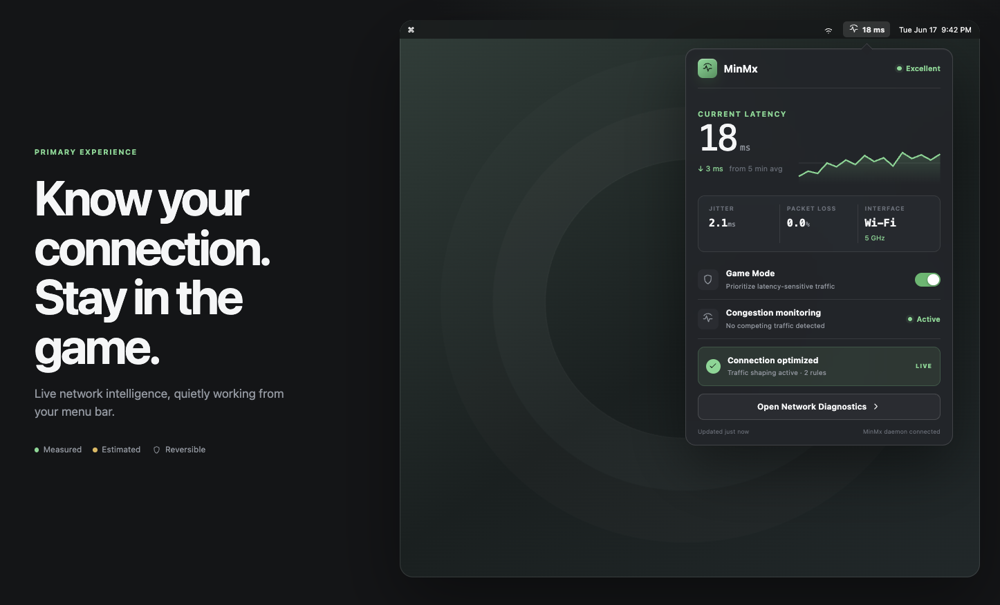
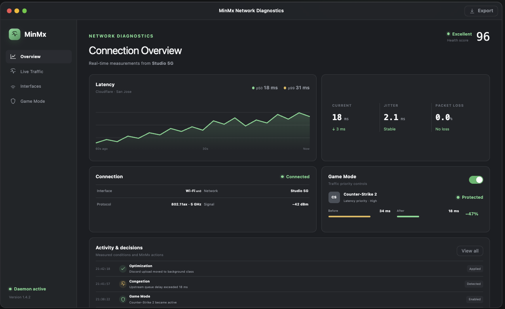
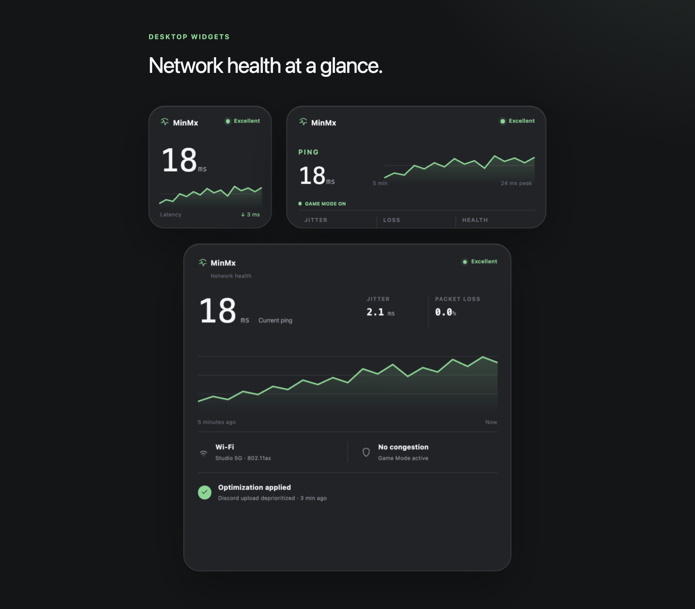

# MinMax



MinMax is a macOS network-intelligence project for keeping latency-sensitive
gaming traffic responsive while a cooperating background workload is using the
network. It is designed as an operating-systems and networking project, not as
a generic “game booster”: it measures what is happening, explains the evidence,
and only asks applications that opt in to reduce their own traffic.

The project is being built as an **Objective-C/Swift macOS system**. Swift owns
the modern application, concurrency, measurement, and policy logic. Objective-C
interoperability is part of the planned XPC boundary so that clients can use a
stable Objective-C-compatible transport contract when needed. The current
bootstrap is intentionally Swift-only; the production XPC client/server
boundary will be added after the platform feasibility work is complete.

## What the project is exploring

MinMax uses a small local system of independent processes:

1. A game-probe client sends controlled UDP probes and measures round-trip time,
   loss, and jitter.
2. A cooperating uploader generates background traffic and can apply an
   application-level rate limit.
3. A daemon aggregates observations from the clients over versioned XPC,
   maintains bounded state, and evaluates network health.
4. A command-line client displays status, explanations, and benchmark reports.

The goal is to detect **latency inflation during controlled congestion**:

```text
stable baseline RTT
        +
rolling p95 RTT under offered load
        ↓
explainable congestion evidence
        ↓
optional rate limit for the cooperating uploader
```

This is deliberately not a kernel extension, VPN, packet interceptor, router
configuration tool, or promise to optimize arbitrary third-party games. It does
not inspect packet payloads or interfere with applications that have not opted
in.

## Screens and project direction

The pictures folder contains the current visual direction for the project:

### Product overview



The overview represents the user-facing goal: make network health visible,
connect measurements to a diagnosis, and show the tradeoff between gaming
latency and background throughput.

### Status widgets



The widgets illustrate the kinds of information the CLI and future macOS
surface should expose: current health, latency trends, active workloads, and
whether mitigation is enabled. These visuals are directional; the current
implementation is focused on the underlying OS and networking primitives.

## OS and networking concepts

MinMax is intended to be a practical study of several macOS systems concepts:

- **Processes and IPC:** independent clients communicate with a long-lived
  daemon instead of sharing in-process global state.
- **XPC and trust boundaries:** transport messages are versioned and validated;
  client-provided identifiers are not treated as proof of identity.
- **Swift concurrency:** actors own mutable telemetry and policy state, while
  bounded queues and explicit cancellation prevent one slow client from
  stalling the system.
- **UDP measurement:** sequence numbers, timestamps, deadlines, late replies,
  duplicate replies, and clean socket shutdown make RTT and loss measurable.
- **Network path observation:** `NWPathMonitor` can describe interface and path
  changes, but a satisfied local path is not treated as proof of end-to-end
  connectivity.
- **launchd lifecycle:** the daemon is intended to run as a per-user
  `LaunchAgent`, with reconnect behavior and safe cleanup.
- **Measurement discipline:** monotonic time is used for elapsed durations;
  rolling windows, percentiles, jitter, and loss are documented rather than
  guessed from a single ping.
- **Failure handling:** malformed messages, overload, daemon restarts, stale
  sessions, and dropped policy acknowledgements are expected scenarios.

The architecture is intentionally staged so each claim can be tested:

```text
UDP probe + echo server
          ↓
bounded metrics and deterministic tests
          ↓
real multi-process XPC
          ↓
daemon lifecycle and reconnects
          ↓
controlled congestion and opt-in mitigation
```

## Requirements

- macOS 14 or newer
- Swift 5.10 or newer (the package uses Swift Package Manager)

## Build and test

From the repository root:

```sh
swift --version
swift build
swift test
```

The package currently provides:

- `MinMaxCore`, the Foundation-only shared library
- `MinMaxGameClient`, a minimal executable placeholder
- `MinMaxEchoServer`, a minimal executable placeholder

Run the placeholders and their help output with:

```sh
swift run MinMaxGameClient --help
swift run MinMaxEchoServer --help
```

## Current implementation status

The repository currently contains the initial Swift package and launchable
placeholders:

- `MinMaxCore`, the Foundation-only shared library
- `MinMaxGameClient`, the future UDP game-probe executable
- `MinMaxEchoServer`, the future controlled UDP echo endpoint

UDP probing, XPC, metrics, and persistent services are deliberately staged for
later tickets. The screenshots describe the product direction; they do not
represent features that are already implemented in this bootstrap.

## Project principles

- Observe before controlling.
- Mitigate only cooperating workloads.
- Keep memory, queues, sessions, and retries bounded.
- Prefer reproducible measurements over invented performance claims.
- Preserve privacy: no packet payloads, browsing history, or unnecessary
  destinations.
- Make failure modes visible and recoverable.

See [PRD.md](PRD.md) for product requirements, [ARCHITECTURE.md](ARCHITECTURE.md)
for system boundaries, and [TASKS.md](TASKS.md) for the staged implementation
plan.
